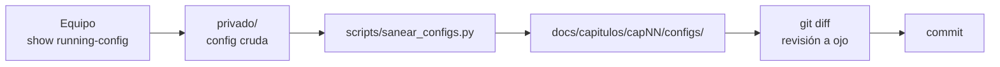

---
tags:
  - cap00
  - documentacion
---

# Estándar de documentación

Convenciones del proyecto. Todo equipo, config, ticket y documento nuevo las sigue. Si una convención deja de servir, se cambia con un ADR, no "de hecho".

!!! info "Estado"
    Versión 1, capítulo 0. Las convenciones de direccionamiento global quedan pendientes (ver [Pendientes](#pendientes)).

## 1. Referentes

Tomamos solo lo práctico de cada uno.

| Referente | Qué tomamos | Dónde se usa |
| --- | --- | --- |
| **ITIL** | Distinción entre *incidente* (restablecer el servicio ya), *problema* (causa raíz de incidentes repetidos) y *cambio* (modificación planificada, con plan y vuelta atrás). | Tipos de ticket en Jira |
| **NIST SP 800-61** | Estructura de análisis posterior a un incidente grave: cronología, causa, qué funcionó, acciones. | Postmortems (cap. 5 en adelante) |
| **ADR** | Una página por decisión de diseño: contexto, decisión, alternativas, consecuencias. | `docs/decisiones/` |
| **Diátaxis** | Cada documento es de un solo tipo (ver tabla abajo). | Todo el sitio |
| **IEC 62443** | Vocabulario de *zonas* y *conductos* para segmentar OT. | Cap. 3 |

### Tipos de documento (Diátaxis)

| Tipo | Pregunta que responde | En este proyecto |
| --- | --- | --- |
| Explicación | ¿Por qué está hecho así? | Página de cada capítulo, ADR |
| Procedimiento | ¿Cómo hago X ahora? | Runbooks (cap. 7), plan de un cambio |
| Referencia | ¿Cuál es el dato exacto? | Inventario, direccionamiento, tablas de VLAN y de VPN |
| Tutorial | ¿Cómo aprendo a hacerlo? | Cómo reproducir el lab desde cero (opcional) |

Regla práctica: si un documento empieza a mezclar "por qué" con "tabla de IPs", partilo en dos y enlazalos.

## 2. Nombres de equipos

Formato: `LL-SEDE-TIPO-FUNCIÓNNN`, en mayúsculas, sin espacios.

Ejemplo: `LL-PLT-SW-DIST01` = Lúpulo Litoral, planta, switch, distribución, número 01.

=== "Sedes"

    | Código | Sede | Aparece en |
    | --- | --- | --- |
    | `GAR` | Garage original | Cap. 1 |
    | `BAR1` | Taproom al lado del garage | Cap. 2 |
    | `PLT` | Planta industrial | Cap. 3 |
    | `DEP` | Depósito (radioenlace) | Cap. 3, secundaria |
    | `GUA` | Bar Gualeguaychú | Cap. 4 |
    | `PAR` | Bar Paraná | Cap. 4 |
    | `MVD` | Oficina Montevideo | Epílogo |

=== "Tipos"

    | Código | Equipo |
    | --- | --- |
    | `RT` | Router |
    | `SW` | Switch |
    | `FW` | Firewall |
    | `WLC` | Controladora inalámbrica |
    | `AP` | Access point |
    | `SRV` | Servidor o VM de servicios |
    | `PC` / `NB` | PC / notebook |
    | `PRN` | Impresora |
    | `CAM` / `NVR` | Cámara / grabador |
    | `POS` | Caja o posnet |
    | `TEL` | Teléfono IP |
    | `IOT` | Sensor (ESP32) |

=== "Funciones"

    | Código | Función |
    | --- | --- |
    | `EDGE` | Borde, salida a internet |
    | `CORE` | Núcleo |
    | `DIST` | Distribución |
    | `ACC` | Acceso |
    | `MGMT` | Gestión |
    | Libre | Para servidores: `MQTT`, `TACACS`, `SYSLOG`, `ZBX`, etc. |

Los equipos que simulan cosas fuera de la empresa (proveedores, internet) **no** llevan el prefijo `LL`: `ISP-A`, `ISP-B`, `INET-CORE`.

## 3. Descripciones de interfaz

Toda interfaz en uso tiene descripción. Formato: `TIPO-to-EQUIPO-INTERFAZ` o `TIPO-función`.

| Caso | Ejemplo |
| --- | --- |
| Enlace entre equipos propios | `UPLINK-to-LL-PLT-SW-DIST01-Gi1/0/1` |
| Enlace a proveedor | `WAN-to-ISP-A-circuito-12345` |
| Puerto de usuario | `ACC-caja-2` |
| Puerto sin usar | `PARKING` |

Las descripciones son lo primero que mira el que está de guardia a las 3 de la mañana: que alcance con leerlas para entender el diagrama.

## 4. Direccionamiento y VLANs

Reglas que valen en todas las sedes:

| Rango del /24 | Uso |
| --- | --- |
| `.1` | Gateway (IP virtual cuando haya FHRP) |
| `.2` a `.9` | Infraestructura (IPs reales de HSRP, interfaces de equipos de red) |
| `.10` a `.49` | IPs fijas: servidores, impresoras, cámaras, grabadores |
| `.50` a `.254` | Pool DHCP |

| VLAN | Uso fijo |
| --- | --- |
| 99 | Gestión de equipos de red |
| 998 | Nativa de los trunks (sin hosts) |
| 999 | `PARKING`: puertos sin usar, además apagados |

Las IPs fijas se registran en el [inventario](inventario.md) **antes** de configurarlas.

## 5. Configuración base

Lo mínimo que todo equipo de red tiene desde el día uno. Se amplía en el cap. 6.

- [ ] Hostname según la convención.
- [ ] Usuario local con privilegio y contraseña con hash fuerte; `enable secret`, nunca `enable password`.
- [ ] SSH v2 únicamente; telnet deshabilitado en las líneas VTY.
- [ ] Banner de acceso autorizado.
- [ ] `service password-encryption` (solo ofusca las contraseñas tipo 7; no reemplaza un hash).
- [ ] Timeout de sesión en consola y VTY.
- [ ] Puertos sin usar apagados y en VLAN 999.
- [ ] Descripciones en todas las interfaces en uso.

## 6. Configs en el repo y secretos

!!! danger "Regla sin excepciones"
    Ninguna contraseña, hash, PSK, clave de TACACS+/RADIUS ni comunidad SNMP llega al repo. El repo es público.

Flujo:



- `privado/` está en `.gitignore`: ahí van las configs crudas.
- `scripts/sanear_configs.py` reemplaza los secretos por `<SANEADO>`. Cubre IOS, FortiOS, VyOS y pfSense; sus limitaciones están en el encabezado del script.
- El CI corre `sanear_configs.py --verificar docs` en cada push: si encuentra un secreto, el sitio no se publica.
- Si un secreto se sube por error: **se cambia el secreto** en el equipo. Borrarlo del historial de git no alcanza, porque ya pudo ser copiado.

Nombre de archivo de config: el hostname, en `.txt` (por ejemplo `LL-GAR-RT-EDGE01.txt`). Los `.pkt` de Packet Tracer van en la carpeta del capítulo, también sin contraseñas reales.

## 7. Tickets, cambios y Jira

Herramienta: Jira Service Management, proyecto con clave `LL` ([ADR-002](../decisiones/adr-002-gestion-tickets.md)).

- Todo trabajo arranca como ticket en Jira, con tipo (incidente, problema, cambio, consulta), prioridad, sede y capítulo (como etiquetas de Jira: `sede-planta`, `cap-03`).
- La clave de Jira **es** el nombre del ticket: `LL-12` se documenta en `docs/capitulos/capNN-*/tickets/LL-12.md`. Una sola numeración.
- Jira es el trabajo en curso; el `LL-NN.md` es el informe final que queda en el portfolio. **Un ticket no se cierra en Jira hasta que su informe está en el repo.**

Sitio: `lupulo-litoral.atlassian.net`. Cómo se mapea el proyecto a lo que trae el plan gratuito:

| Tipo de ticket (ITIL) | En Jira | Tipo de solicitud del portal |
| --- | --- | --- |
| Incidente | `[System] Incident` | Reportar una falla |
| Cambio | `[System] Service request` + etiqueta `cambio` | Solicitar un cambio |
| Consulta | `[System] Service request` | Hacer una consulta |
| Problema | `Tarea` + etiqueta `problema`, enlazada a los incidentes que la originaron | — (lo crea el agente) |

| Prioridad | En Jira | Criterio en Lúpulo Litoral | Ejemplo |
| --- | --- | --- | --- |
| P1 | Highest | El negocio no puede operar | Ningún bar cobra con tarjeta |
| P2 | High | Servicio degradado o una sede afectada | Paraná sin VPN |
| P3 | Medium | Molestia con alternativa | La impresora de etiquetas no aparece |
| P4 | Low | Mejora o consulta | Documentar un SSID nuevo |

Etiquetas de Jira: `sede-garage`, `sede-bar`, `sede-planta`, `sede-gualeguaychu`, `sede-parana`, `sede-todas` y `cap-00` a `cap-07`.

## 8. Commits

Formato: `tipo(sede): descripción LL-NN` (la clave del ticket de Jira)

| Tipo | Uso |
| --- | --- |
| `feat` | Funcionalidad nueva en la red (una VLAN, una VPN) |
| `fix` | Corrección de una falla |
| `config` | Actualización de configs exportadas |
| `docs` | Solo documentación |
| `chore` | Mantenimiento del repo (scripts, CI) |

Ejemplos:

```text
feat(bar): VLANs y trunk hacia el switch L3 LL-8
fix(bar): ACL WIFI en dirección in LL-12
docs(general): estándar de documentación v1
```

Con la app *GitHub for Jira* instalada, la clave `LL-12` en el mensaje hace que el commit aparezca dentro del ticket.

## 9. Idioma y estilo

- Documentación en español. Comandos, salidas y términos técnicos sin traducir (`trunk`, `show ip route`).
- Cada página de capítulo cierra con un resumen en inglés (*Summary*) de 4 a 6 líneas.
- Escribí para otro técnico que retoma tu trabajo sin poder preguntarte.
- Cada decisión técnica se justifica con una necesidad del cliente.

## 10. Etiquetas del sitio

Cada página lleva en el encabezado etiquetas de capítulo y de tema. Las de tema usan el nombre corto del tema en minúsculas (`vlan`, `ospf`, `ipsec`, `stp`, `dhcp`, `nat`, `ipv6`, `bgp`, `sd-wan`, `tacacs`), de modo que la página de [etiquetas](../etiquetas.md) funcione como mapa de evidencia por tema.

## Pendientes

- **Plan de direccionamiento global.** Antes del cap. 2, decidir con un ADR cómo se numeran las redes de cada sede pensando en lo que viene en el cap. 4.
