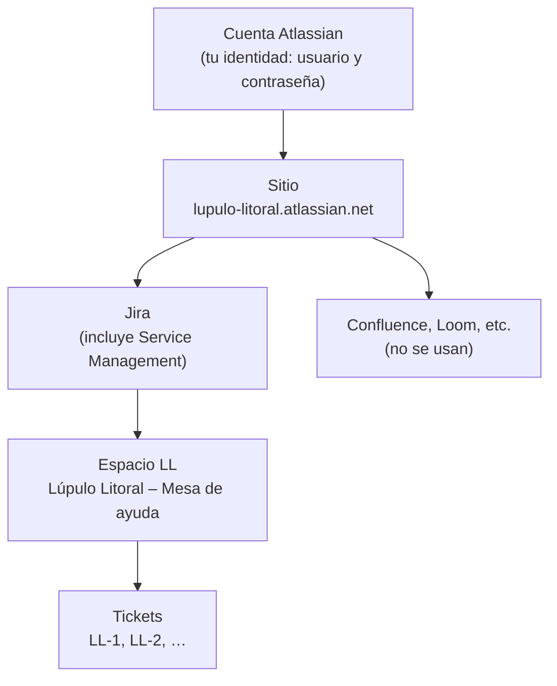
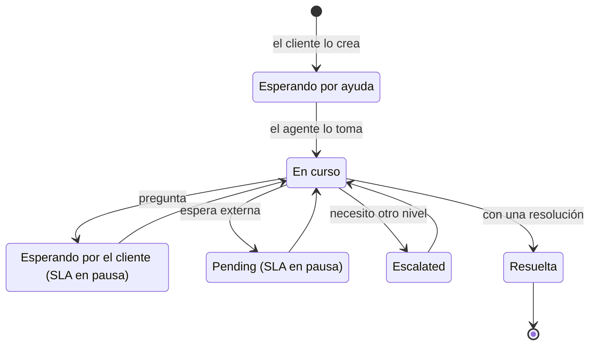

---
tags:
  - cap00
  - jira
  - documentacion
---

# Cómo funciona la mesa de ayuda

Resumen de cómo está armada la mesa de ayuda de Lúpulo Litoral en Jira Service Management: qué simula, cómo se entra según el rol, qué se configuró y por qué, y cómo se atiende un ticket. La decisión de usar Jira está en el [ADR-002](../decisiones/adr-002-gestion-tickets.md).

## 1. Qué simulamos

Lúpulo Litoral no tiene un área de sistemas: tiene un consultor externo (yo) que les resuelve todo lo de red. Cuando algo falla o necesitan un cambio, no me escriben por WhatsApp: abren un ticket en el **portal de la mesa de ayuda**. Yo lo atiendo como **agente**, con prioridades, tiempos comprometidos (SLA) y un cierre documentado.

| Rol en la historia | Rol en Jira | Quién lo maneja |
| --- | --- | --- |
| Martín, Sofi (y más adelante Lucas, Carla) | **Clientes**: solo ven el portal y sus tickets | Claude los interpreta y abre tickets a su nombre; también se puede entrar como ellos |
| El consultor de redes | **Agente** y administrador: ve las colas, atiende, configura | Adrián |

### Mesa de ayuda no es lo mismo que NOC

- La **mesa de ayuda** (*service desk*) recibe lo que **las personas reportan**: "no tengo internet". Reacciona.
- El **NOC** (*Network Operations Center*) **vigila la red** con monitoreo y se entera antes de que alguien llame. Anticipa.

Desde el capítulo 1 el proyecto tiene mesa de ayuda. El NOC aparece en el capítulo 4 (Zabbix básico) y se completa en el 7, cuando las alertas abren tickets solas.

## 2. Cómo se ordena Atlassian

- **Atlassian** es la empresa. Tu **cuenta Atlassian** es tu identidad: con el mismo usuario entrás a cualquiera de sus productos. Por eso el registro y el conector de Claude dicen "Atlassian" y no "Jira".
- El **sitio** es el "edificio" donde viven las herramientas. Entrar "desde Atlassian" o "desde Jira" te deja en el mismo lugar, con el mismo usuario.
- **Jira** es la aplicación de tickets. *Jira Service Management*, la versión de mesa de ayuda, ahora viene dentro de Jira.
- Un **espacio** (antes se llamaba *proyecto*) agrupa los tickets de un equipo. El nuestro tiene la clave `LL`, que es el prefijo de cada ticket.

## 3. Por dónde se entra

| Para qué | Dirección | Quién |
| --- | --- | --- |
| Atender tickets (colas) | `https://lupulo-litoral.atlassian.net` → Jira → espacio *Lúpulo Litoral – Mesa de ayuda* → **Colas** | Agente |
| Abrir un ticket puntual | `https://lupulo-litoral.atlassian.net/browse/LL-1` | Agente |
| Configurar el espacio (tipos de solicitud, SLA, clientes) | Dentro del espacio → **Configuración del espacio** | Agente administrador |
| Configurar todo el sitio (resoluciones, flujos, usuarios) | **Engranaje** de arriba a la derecha | Administrador del sitio |
| Portal de clientes | `https://lupulo-litoral.atlassian.net/servicedesk/customer/portals` | Clientes |
| Portal de la mesa de ayuda (directo) | `https://lupulo-litoral.atlassian.net/servicedesk/customer/portal/2` | Clientes |

!!! tip "Entrar como cliente"
    Usá una **ventana de incógnito**. Si el navegador tiene abierta la sesión de agente, el portal te reconoce como agente y no ves lo mismo que ve un cliente.

**Configuración del espacio** y **engranaje** son cosas distintas. La configuración del espacio afecta solo a `LL`. El engranaje afecta a todo el sitio. Las resoluciones, por ejemplo, se crean desde el engranaje porque son globales.

### Qué puede hacer Claude

Claude está conectado al sitio con el conector de Atlassian, usando tus permisos. Puede crear tickets a nombre de los clientes, comentar, cambiar estados y leer la configuración y los SLA. No puede cambiar la configuración del espacio ni la del sitio: eso se hace desde la interfaz.

## 4. Qué se configuró y por qué

| Qué | Cómo quedó | Por qué |
| --- | --- | --- |
| Espacio | *Lúpulo Litoral – Mesa de ayuda*, clave `LL`, plantilla de gestión de servicios de TI | La clave corta es el prefijo de los tickets y de los informes del repo (`LL-12.md`) |
| Acceso al canal | **Restringido** | Mínimo privilegio: solo abren tickets los clientes dados de alta. Con "Abierto", cualquiera en internet podría hacerlo |
| Tipos de solicitud (lo que ve el cliente) | **Reportar una falla** (genera un *incidente*), **Solicitar un cambio** y **Hacer una consulta** (generan *solicitudes de servicio*), y **Emailed request** (canal por mail) | Pocas puertas de entrada y claras. Se borraron las de ejemplo (alta de empleados, hardware, licencias) |
| Formularios | Campos traducidos; el cliente no elige impacto ni urgencia | La prioridad la decide el agente con el criterio del [estándar](estandar-documentacion.md#7-tickets-cambios-y-jira): clasificar es parte del trabajo del N2 |
| Clientes | Martín y Sofi, en la organización **Lúpulo Litoral** | La organización hace que se vean los tickets entre compañeros. Carla va a ir en otra organización, para que no vea los internos |
| Resoluciones | Hecho, No se puede reproducir, Duplicado, No se hará | El sitio no traía ninguna y no se podía cerrar ningún ticket. Se crean desde el engranaje |
| SLA | Primera respuesta y resolución, con objetivos según la prioridad | Ver la tabla de SLA en el [estándar](estandar-documentacion.md#sla) |
| Calendario | *Horario laboral*: lunes a viernes de 9 a 18, Buenos Aires | P1 y P2 cuentan 24/7 (los bares cobran de noche); P3 y P4 solo en horario laboral |
| Espacio "IT Service Project" | Eliminado | Lo creó solo el asistente de registro; con uno solo no hay riesgo de cargar tickets en el equivocado |

Limitaciones del plan gratuito: no trae tipos de *problema* ni de *cambio* como en ITSM completo. Un cambio es una solicitud de servicio con la etiqueta `cambio`; un problema es una tarea con la etiqueta `problema`, enlazada a sus incidentes.

## 5. El recorrido de un ticket

Los incidentes usan un flujo parecido con otros nombres (*Abierta → Investigar → Completado*). La lógica es la misma.

### Qué frena cada reloj

| SLA | Arranca | Se pausa | Se detiene |
| --- | --- | --- | --- |
| Primera respuesta | Cuando se crea el ticket | — | Con una **respuesta al cliente** o al resolver |
| Resolución | Cuando se crea el ticket | En *Esperando por el cliente* y *Pending* | Al **resolver** |

Si le preguntás algo al cliente sin cambiar el estado, el reloj de resolución sigue corriendo.

### Respuesta al cliente y nota interna

- **Responder al cliente:** la ve el cliente y le llega por mail. Lo que sale no se puede despublicar, así que revisalo antes de enviar.
- **Nota interna** (fondo amarillo): solo la ven los agentes. Ahí van los comandos, las hipótesis y lo que vas descartando.

## 6. Rutina de cada ticket

1. **Asignarte** el ticket.
2. **Fijar la prioridad** según el estándar (P1 a P4). El SLA se recalcula solo.
3. **Primera respuesta** al cliente: que sepa que lo viste.
4. **Diagnosticar** en el lab y anotar los pasos en **notas internas**.
5. Si dependés del cliente o de un tercero, cambiar el estado a **Esperando por el cliente** o **Pending**.
6. **Escribir el informe** `docs/capitulos/capNN-*/tickets/LL-NN.md` con la [plantilla](plantillas.md#ticket-de-incidente) y hacer commit mencionando la clave (`fix(bar): ACL WIFI en dirección in LL-12`).
7. **Resolver** con una resolución honesta: *Hecho* solo si se conoce la causa; *No se puede reproducir* si "se arregló solo".
8. Agregar la fila en el [índice de tickets](../tickets/index.md).

Regla: **un ticket no se cierra en Jira hasta que su informe está en el repo.** Jira es privado; el portfolio son los informes.

## 7. Glosario

| Término | Qué es |
| --- | --- |
| Agente | Quien atiende tickets. Usa una licencia (el plan gratuito permite 3) |
| Cliente | Quien pide ayuda por el portal. No usa licencia |
| Organización | Grupo de clientes de una misma empresa |
| Espacio | Contenedor de tickets con su configuración (antes, "proyecto") |
| Tipo de solicitud | Opción que ve el cliente en el portal ("Reportar una falla") |
| Tipo de actividad | Lo que se genera por detrás (*Incident*, *Service request*) |
| Cola | Lista filtrada de tickets para el agente (*All open*, *Assigned to me*) |
| SLA | Tiempo comprometido para responder o resolver, según la prioridad |
| Resolución | Cómo terminó el ticket (Hecho, Duplicado…); obligatoria al cerrar |
| Portal | La vista del cliente, el centro de ayuda |

---

!!! abstract "Summary (English)"
    How the Lúpulo Litoral help desk works in Jira Service Management (free plan): an Atlassian site with one service space (`LL`), restricted to invited customers (the story's characters) grouped in an organization, three request types (report an outage, request a change, ask a question), resolutions, and two SLAs (first response and resolution) with priority-based goals on 24/7 and business-hours calendars. It explains the agent and customer entry points, the ticket lifecycle and what pauses each SLA, the per-ticket routine, and the difference between a service desk and a NOC.
